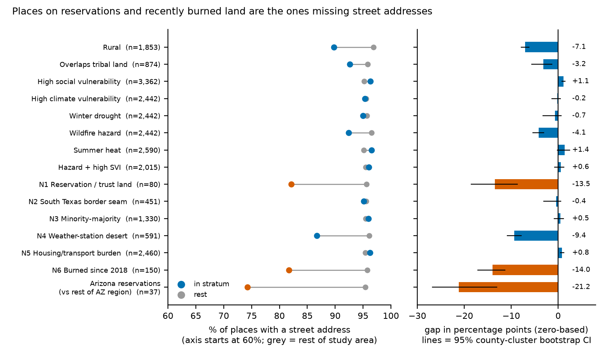
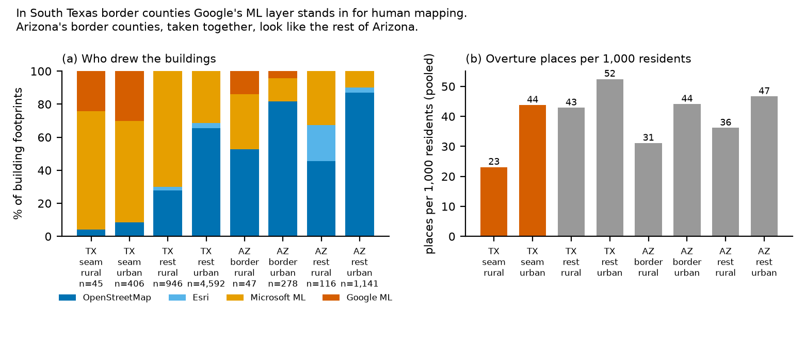
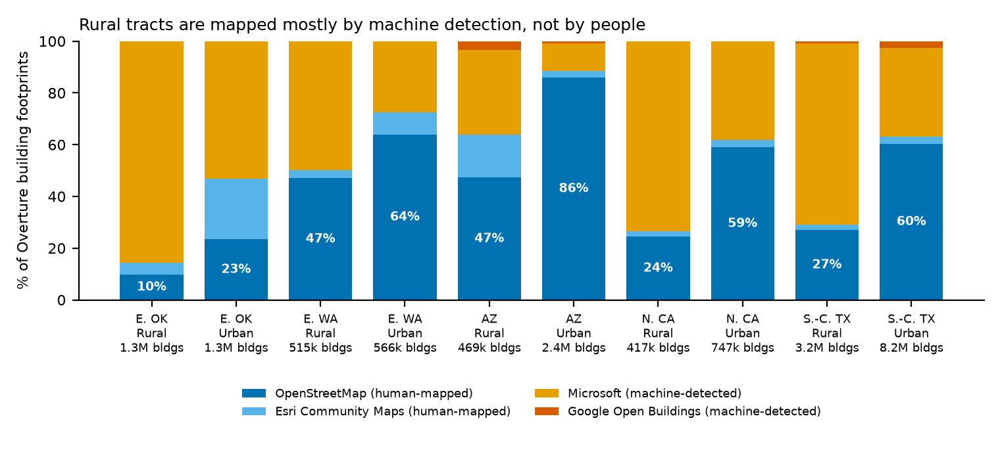
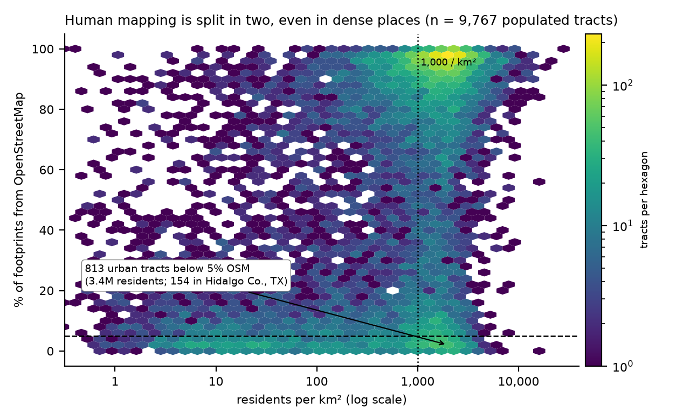
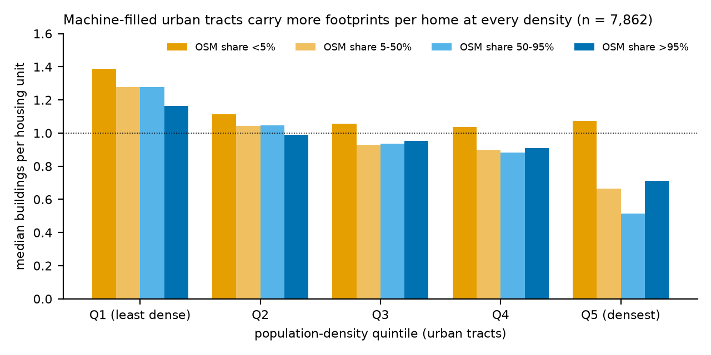

# Executive summary

Overture Maps is assembled from several upstream pipelines, and which pipeline maps a neighbourhood follows who lives there. We traced the source of 19.2 million buildings and 2.0 million places across all 9,794 scored tracts in five regions and found gaps the scorecard cannot see:

* **Overture omits street addresses for places on reservations.** 82% of places have one, against 96% elsewhere; 44% in one Tohono O'odham Nation tract. The gap survives every control and county clustering (−7.7 points), and nearly all of it sits in Meta-sourced listings.
* **A South Texas border seam.** In nine border counties (1.7 million residents), Google's machine-learned layer supplies 29% of footprints and human mappers 8%, against 55% elsewhere in the region. Arizona's border counties show no such seam.
* **Rural buildings are machine-detected.** Only 4.5% say what they are (home, school, barn), against 27% elsewhere.
* **813 urban neighbourhoods (3.4 million residents) have under 5% human-mapped buildings**, 154 of them in Hidalgo County, Texas.

Here a 911 dispatcher may fail to geocode a call, a damage assessor cannot tell a home from a shed, and relief lists miss homes. We recommend per-area source reporting, tribally led address channels and lower-confidence flags (section 8).

*Measured vs inferred:* every figure above is measured from the challenge data. Statements about consequences, and about how these patterns move the hidden coverage-gap score, are inferences and are labelled as such.

**Robustness at a glance.** "Survives" means the effect holds after clustering standard errors by county, a wild-cluster bootstrap and a Holm correction across all 28 regression terms. Details are in section 1.

| Finding | Effect after controls | Bootstrap p | Holm-adjusted p | Status |
|------------------|-------------|------|------|-------------|
| F1 Reservation places lack addresses | −7.7 pts | 0.001 | 0.027 | **survives** |
| F2 South Texas seam: less human mapping | −50 pts OSM share | 0.002 | 0.036 | **survives** |
| F2 South Texas seam: fewer places per resident | −31% | 0.005 | 0.083 | suggestive |
| F3 Rural: less human mapping | −7.9 pts OSM share | 0.001 | 0.024 | **survives** |
| F3 Social vulnerability: less human mapping | −12 pts per unit of SVI | 0.012 | 0.17 | suggestive |
| F4 ML-only neighbourhoods are more vulnerable | SVI 0.65 vs 0.56 | 0.07 | n/a | weak (driven by a few counties) |
| F5 ML-filled tracts have more footprints per home | −20% per 100 pts of OSM share | 0.001 | n/a | holds; −15% within counties (p = 0.06) |

# 1. Data, definitions and statistics

```{=latex}
\begin{origfigure}[tp]
\centering
\includegraphics[width=\textwidth]{fig/fig0_maps.png}
\caption{Where the gaps are, drawn from the challenge's own tract polygons. (a) OSM share of footprints across the South Texas border seam; (b) share of places with a street address in the Arizona region, with reservation and trust-land tracts outlined; (c) Hidalgo County, where 154 of 199 urban tracts are below 5\% OSM.}
\end{origfigure}
```

**Data.** We use only the challenge package: Overture release 2026-08-19.0 (buildings, places, roads), ACS housing units, the tract polygons and attributes shipped in `strata/<region>/<region>-census-tracts.parquet`, and the strata tables. We did not read or rebuild any removed reference layer (TIGER roads, Microsoft footprints, facility counts, County Business Patterns). The USFS and CarbonPlan columns that count buildings, homes or people are dropped when the master table is built (`build_master.py`), because they may derive from Microsoft footprints. The analysis covers the 9,767 populated tracts.

**What we measure.** For each Overture feature we take its upstream source (`sources[0].dataset`): OpenStreetMap (OSM, human-mapped), Esri Community Maps, Microsoft or Google machine-learned (ML) footprints, and for places Meta, Microsoft, Foursquare and others. We also record whether the attributes are filled in: building class, name or floor count, and for places a street address or website. Each building is assigned to the tract containing the centre of its bounding box; each place to the tract containing its point.

**One border definition.** The *South Texas border seam* is the set of tracts in the nine study-area Texas counties that touch the US–Mexico border: Cameron, Hidalgo, Starr, Zapata, Webb, Maverick, Kinney, Val Verde and Terrell. That is 451 populated tracts and 1.75 million residents. The definition is geographic, so it does not depend on any Overture value. The *Arizona contrast* is the four Arizona border counties plus one New Mexico tract (325 tracts). "Google-present" tracts (Google >5% of footprints) are described but never used to test lineage, since that would be circular.

**Statistics.** Regressions use OLS with region fixed effects, standard errors clustered by county (325 clusters) and wild-cluster bootstrap p-values (4,999 draws). Holm and Benjamini–Hochberg (BH) adjustments are applied across all 28 terms of the four main models. Stratum comparisons use a county-cluster bootstrap (2,000 draws) for 95% intervals; BH q-values are taken across all 90 stratum × indicator tests (57 have q < 0.05). Tracts with missing SVI (61 populated) are excluded from both sides of SVI comparisons. Every number in this report is written by a script to `reports/tables/report_numbers.csv`.

> **Glossary.** *Lineage* (or source): which upstream dataset supplied a feature. *ML footprint*: a building outline detected by a machine-learning model from imagery. *OSM*: OpenStreetMap, mapped by people. *Conflation*: Overture's merging of sources; OSM wins where both exist. *SVI*: CDC Social Vulnerability Index percentile (0–1). *Tract-weighted*: each tract counts once. *Place-weighted*: each place counts once. *Clustered SE*: an uncertainty estimate that allows tracts in the same county to be correlated.

# 2. Finding 1: Overture omits street addresses for places on reservations

Across the 80 populated tracts on legal reservation or trust land (34 areas in 28 counties; 294,612 residents), **82.1% of Overture places carry a street address, against 95.6% elsewhere** (tract-weighted). Counting each place once, the figures are 88.2% vs 96.9%. In the Arizona region the tract-weighted figure is **74.3% (37 tracts) against 95.4%**; for rural Arizona tracts alone it is 66.2% against 82.9%.

**It is not rurality.** After controlling for rurality, density, social vulnerability, region and the border, reservation tracts still have **7.7 points fewer addressed places** (county-clustered t = −3.8; bootstrap p = 0.001; Holm p = 0.027). Rural status itself has no effect (−0.1 points, t = −0.3). The gap holds when clustering by reservation instead of county (t = −3.1, p = 0.003). It also holds after adding Meta's share of places and the number of places (−7.0 points, p = 0.001). Weighting by places, it shrinks to −3.5 points (t = −2.0, p = 0.045). The reason is that the large, well-addressed tracts dominate, so the gap is concentrated in tracts with few listed places.

**Where the missing addresses come from.** Across the study area, **95% of address-less places are Meta listings**, although Meta supplies 61% of places. On reservations, Meta supplies more of the places (71% vs 60%), and its listings are far more often address-less: 83.6% have an address against 95.1% elsewhere. Places from every other provider are 99% addressed in both groups (`reservation_place_sources.csv`). Among Meta listings alone, the reservation gap is −4.5 points after controls (p = 0.026). This is a concrete, fixable provider-level issue.

| Tract | Nation (official name) | Residents | Places | With address (95% CI) | Meta share |
|------|----------------|----|---|------|---|
| 04019941100 | Tohono O'odham Nation | 2,421 | 43 | 44% (30–59%) | 95% |
| 04017940014 | Navajo Nation | 2,382 | 31 | 45% (29–62%) | 90% |
| 04005945100 | Navajo Nation | 3,342 | 70 | 47% (36–59%) | 86% |
| 04009940500 | San Carlos Apache Tribe | 4,720 | 72 | 49% (37–60%) | 93% |
| 04017940015 | Navajo Nation | 4,071 | 47 | 49% (35–63%) | 83% |
| 04001970202 | Pueblo of Zuni | 2,610 | 82 | 52% (42–63%) | 79% |
| 04017940100 | White Mountain Apache Tribe (Fort Apache) | 4,282 | 62 | 55% (43–67%) | 90% |

*Lowest-address reservation tracts with 500+ residents (`examples_reservation_low_address.csv`); Wilson 95% intervals.*

The pattern repeats in eastern Washington. In tracts of the Confederated Tribes and Bands of the Yakama Nation (`53077940003`) 63% of places are addressed (54–71%); for the Confederated Tribes of the Colville Reservation (`53019940000`) the figure is 66% (53–76%). Weather-station deserts (−9.4 points) and recently burned tracts (−14.0 points) show similar address gaps (Figure 2).

{width=92%}

**Why it matters here (decision chain, inferred).** Computer-aided dispatch, routing apps and relief distribution lists all match a place to a location through its address. A clinic, chapter house or store with no address in Overture cannot be geocoded from that record. The Navajo Nation reports about 185,000 structures needing street addresses and says a Nation-wide E-911 system "will rely on the completion of rural addressing" (Navajo Nation Council, 16 Feb 2021). Overture data reaches emergency and planning users directly: Esri adopted Overture buildings as default layers in ArcGIS, and Meta uses Overture in Facebook and Instagram maps (Overture Maps Foundation, Feb 2026). A missing address in Overture is not always a mapping failure, though. Navajo household addressing data is shared with dispatch services but "not made public" (ICT, 2015). Remedies should therefore follow the CARE Principles for Indigenous Data Governance: improve emergency access through channels the tribes control, not by scraping or imputing addresses.

# 3. Finding 2: the South Texas border seam

Google Open Buildings appears in Overture in only 289 of the 9,794 scored tracts (292,088 footprints). Of the 287 populated Google tracts, **285 lie in counties on the international border**; the other two are in Dimmit County, Texas, which adjoins two seam counties. In the nine seam counties Google supplies **29% of footprints and OSM only 8%**, against 55% OSM in the rest of the Texas region (pooled over footprints). Overture's documentation shows the same Google/Microsoft mixing at the San Diego–Tijuana border. Our inference is that Google's coverage, built for Latin America, reaches a few tens of kilometres into the US.

After controls, seam tracts have **50 points less OSM share** (t = −10.2; bootstrap p = 0.002; Holm p = 0.036). They also have **31% fewer places per resident** (p = 0.005; Holm p = 0.083) and 16 points fewer place websites (p = 0.010; Holm p = 0.15). Street addresses are not lower (−1.6 points, p = 0.06). The seam is among the most socially vulnerable parts of the study area: mean SVI 0.84, against 0.56 in the rest of the region.

**Arizona is the contrast.** The four Arizona border counties, taken together, have 76% OSM share against 81% in the rest of the Arizona region, and their controlled effect is zero (−0.1 points, p = 0.98). Google fill does appear in individual Cochise County tracts (for example `04003000902`, 82% Google). But Tucson's well-mapped tracts dominate the county totals, so no county-wide deficit appears. The seam is therefore a South Texas phenomenon. That points to an upstream coverage boundary, not to "the border" as such.

**Named tracts.** Maverick County `48323950702` (5,399 residents; 87% Google, 2% OSM; 18.5 places per 1,000 residents against a median of 37.8 in the rest of the region). `48323950206`, the tract of the Kickapoo Traditional Tribe of Texas Reservation (28% Google, 7% OSM, 19.6 places per 1,000).

{width=92%}

**Why it matters here (inferred).** These counties hold most of Texas's colonias. The Texas Secretary of State's 2014 count, republished by TDHCA, lists 937 colonias in Hidalgo (about 150,000 residents), 256 in Starr, 196 in Cameron, 74 in Maverick and 62 in Webb. Footprints there are drawn by a different pipeline from the one used a few kilometres north. Any analysis that merges or compares footprint sources could read the pipeline boundary as real change: before/after damage comparison, insurance exposure, or change detection. Fewer listed places per resident also means thinner points of interest for routing and relief logistics.

# 4. Finding 3: rural buildings are machine-detected and say nothing about use

Rural tracts get **26.5% of their footprints from OSM, against 61.6% elsewhere** (pooled over footprints; the tract-weighted figures are 25% vs 64%). The difference matters because attributes depend on source. In every region, **0% of Microsoft and Google footprints carry a class, name or floor count**, while OSM footprints carry a class 21–47% of the time. So **4.5% of rural footprints say what the building is, against 26.8% elsewhere (5.9 times fewer)**. After controls, rural tracts have 7.9 points less OSM share (bootstrap p = 0.001; Holm p = 0.024). Higher social vulnerability goes with less human mapping (−12 points per unit of SVI, p = 0.012), but this does not survive the Holm correction. Tracts overlapping tribal land have far less OSM in raw terms (0.20 vs 0.61), but once density and rurality are held fixed there is no tribal-specific building deficit. For buildings, the tribal gap is a rurality gap. For places, it is not (Finding 1).

{width=88%}

**Why it matters here (inferred).** Wildfire and flood exposure counts, preliminary damage assessment and shelter planning all need to separate homes from barns, schools and sheds. In rural tracts, Overture's footprints usually cannot do that.

# 5. Finding 4: "ML-only" urban neighbourhoods

Human mapping is split in two even in dense places (Figure 5). **813 urban tracts with 3,365,435 residents have less than 5% OSM footprints.** They lie in 100 counties, but they cluster. In Hidalgo County, 154 of 199 urban tracts (77%) are ML-only.

| County | ML-only urban tracts | Share of county's urban tracts | Residents | Mean SVI |
|------|-----|-----|-----|----|
| Hidalgo, TX | 154 | 77% | 648,581 | 0.84 |
| Harris, TX | 103 | 10% | 473,037 | 0.56 |
| Oklahoma County, OK | 62 | 25% | 183,236 | 0.60 |
| Bexar, TX | 55 | 15% | 229,709 | 0.76 |
| Cameron, TX | 46 | 45% | 168,553 | 0.78 |
| Webb, TX | 31 | 49% | 137,629 | 0.79 |
| Montgomery, TX | 30 | 29% | 150,326 | 0.32 |
| Brazoria, TX | 29 | 46% | 147,123 | 0.39 |
| Fort Bend, TX | 27 | 21% | 144,706 | 0.39 |
| Starr, TX | 12 | 100% | 48,444 | 0.95 |

*Top 10 counties by count (`mlonly_by_county.csv`, all 100 counties listed there).*

{width=66%}

On average these tracts are **more socially vulnerable** than other urban tracts (mean SVI 0.65 vs 0.56; SVI minority percentile 0.73 vs 0.65). However, the difference is **not robust to county clustering (p = 0.07)**: it is driven by Hidalgo, Cameron, Webb and Starr, while the suburban Houston counties (Montgomery, Brazoria, Fort Bend) are ML-only *and* low-SVI. The robust facts are what these tracts lack: semantic building attributes (0.8%) and place websites (73% vs 82%). Examples (100% Microsoft footprints): Hidalgo `48215021906` (5,598 residents; SVI 0.73; 33% of places with a website), `48215022503` (SVI 0.93), and Harris `48201433505` (SVI 0.95; 189 footprints for 785 homes). For contrast, Dallas `48113013605` (SVI 0.09) is 99.9% OSM, and 99.8% of its footprints have attributes.

# 6. Why the building benchmark itself may be circular (inferred)

The challenge scores building coverage by comparing Overture's building count with Microsoft's footprints. But Overture *is* Microsoft footprints wherever no human mapper has drawn the area. In **3,618 tracts (37% of tracts with buildings; 14.2 million residents), at least half of Overture's footprints are Microsoft ML.** There, Overture and the benchmark share a source, so they should agree almost by construction. The exceptions would be footprints under 10 m², which Overture drops by design, and any release differences.

Where people have redrawn the map, Overture holds *fewer* footprints per home. In urban tracts the median is **1.15 buildings per housing unit at <5% OSM (813 tracts) against 0.91 at >95% OSM (2,087 tracts)**. The ML-filled tracts have more footprints per home in all five density quintiles (Figure 6). With region fixed effects, moving from 0% to 100% OSM goes with **20% fewer footprints per home** (t = −4.3, p = 0.001). Comparing tracts within the same county, the figure is 15% (t = −2.7, p = 0.06). One likely reason is that mappers merge or skip sheds and attached structures that ML detects separately.

{width=72%}

*Implication (inferred, untestable without the removed reference).* A count-based building gap will tend to score **human-mapped** tracts as *worse* covered, and machine-filled tracts as complete even when their footprints carry no type, name or address. The building component of the scorecard partly measures *which pipeline drew the map*, not whether communities are on it. So the rural and tribal gaps the scorecard reports probably come more from places and roads than from buildings. The 10 m² floor pulls the other way, but weakly. Overture documents that ML footprints need "a footprint area greater than 10m" (sic). In northern California only 9 of 592,043 Microsoft footprints are below 10 m², about 2,000 fall in each 2 m² band from 10 to 20 m², and 0.24% of OSM footprints are below 10 m². If the density just above the floor continued below it, about 1.7% of ML footprints would be missing. That is an illustration, not a measurement.

# 7. Weaker and null results, reported honestly

* **Fire vintage, northern California only.** In the 150 tracts with ≥30% of land burned since 2018, 85% have a mean footprint source date older than their last fire. But 78% would be expected anyway, because 58% of those fires were in 2025. Against a null of unburned tracts in the same region, only northern California shows excess staleness: 70% vs 56% (64 tracts; p < 0.001 assuming independence, which overstates certainty). Eastern Washington (98% vs 98%) and Arizona (91% vs 89%) do not. Paradise (Camp Fire, 2018) was re-mapped: 91–99.8% of its footprints carry 2020+ source dates. *Caveat:* `update_time` dates the source record, not the imagery.
* **Nulls that sharpen the claims.** Minority-majority tracts (N3) and housing/transport-burden tracts (N5) show *no* address deficit. N3 tracts do have fewer places per resident (37 vs 51 per 1,000), so the reservation address gap is not a general minority effect. Tribal statistical areas, including Muscogee (Creek) Nation tracts that the Census labels "Creek OTSA", show no robust effect on any outcome (all Holm p ≥ 0.75). This is despite striking individual tracts such as `40143009014` (6 places for 1,924 residents). In 2020 the US Supreme Court held that the Creek reservation remains an Indian reservation for purposes of federal criminal law. The statistical-area flag in the strata tables therefore understates reservation status in eastern Oklahoma.
* **Comparison with a leaderboard scorecard (directional only).** We compared our stratum ratios with the eight disparity ratios displayed on the public leaderboard for a top-ranked entry. We cannot verify how that entry was produced. **We tried seven indicators** and report all of them (`scorecard_agreement_tests.csv`). The two best rank-correlations are missing addresses (ρ = 0.88; exact one-sided p = 0.004; Bonferroni ×7 p = 0.025) and non-OSM share (ρ = 0.74; p = 0.023; Bonferroni p = 0.16). Non-OSM share gets drought and heat in the wrong direction. With eight overlapping strata, this is suggestive only.

# 8. Who is affected and what to do

**Who is affected (overlapping groups, five regions):** 294,612 residents of reservation and trust-land tracts (2.9 million in tracts overlapping any tribal land), 1.75 million in the South Texas border seam, 6.5 million in rural tracts and 3.4 million in ML-only urban neighbourhoods. The groups overlap, so they must not be added together.

| # | Owner | Action | Finding | How to tell it worked |
|--|--------|-------------------|---|--------|
| R1 | Overture Maps Foundation | Publish a per-area source summary with each release: share of features by source, and share with class/name/address, per tract or H3 cell | F1–F5 | Users can flag ML-only areas without reprocessing 19 M footprints |
| R2 | Overture + Meta (places) | Audit why Meta listings on reservations lack addresses (83.6% vs 95.1%); report address completeness by tribal area | F1 | Reservation gap narrows, **with tribal consent** |
| R3 | Overture | Tag or reconcile the Google/Microsoft seam in the nine South Texas counties | F2 | No step change in source mix at the seam |
| R4 | Organisers (Humane Intelligence / Zindi) | Add source and place-provider strata to the scorecard; score the building gap separately where Overture and the benchmark share a source | F5 | Scorecard separates "unmapped" from "mapped by another pipeline" |
| R5 | Emergency managers, 911/NG911 GIS, relief agencies, insurers | Treat tracts with <5% OSM, or reservation tracts with <70% addressed places, as lower-confidence. Do not rely on Overture class or address alone for exposure counts, damage assessment or geocoding; fall back to local or tribal authoritative layers | F1–F4 | Fallback written into standard procedures |
| R6 | OSM US, HOT and Rapid mappers | Prioritise validation in Hidalgo, Cameron, Webb, Starr and Maverick counties with local colonia organisations; map tribal land only at the invitation of, and on terms set by, each nation's GIS or addressing office | F2, F4 | OSM share and attribute coverage rise in listed tracts |
| R7 | Overture | Document the 10 m² ML floor as a known undercount and refresh footprints after large fires, not only famous ones | §6–7 | Floor and refresh noted in release notes |

**Respect and consent.** No tribal nation or colonia organisation was consulted for this analysis. The findings are offered for them to use on their own terms, following the CARE Principles (Collective benefit, Authority to control, Responsibility, Ethics).

# 9. Reproducibility

Everything runs from the challenge's public bucket with no credentials: `bash reports/get_data.sh` (fetches the 35 input files and checks them against `reports/DATA_SHA256SUMS.txt`), then `pip install -r reports/requirements.txt` (pinned versions) and `bash reports/run_all.sh`. The full run takes about 6 minutes on one CPU, and every step is deterministic (bootstrap seed 20261014). Outputs are `reports/tables/*.csv`, `reports/tables/results.json`, `reports/tables/report_numbers.csv` (every number cited here) and `reports/fig/*.png`. The pipeline order and each script's purpose are listed in the Documentation report, section 7.

**External sources (all retrieved 14 Oct 2026; none used in any scored computation):** Overture Buildings Guide, <https://docs.overturemaps.org/guides/buildings/>. Overture Maps Foundation, "Three Years In" (3 Feb 2026), <https://overturemaps.org/blog/2026/three-years-in-how-overture-maps-is-changing-the-way-the-world-builds-maps/>. Navajo Nation Council press release (16 Feb 2021), <https://navajonationcouncil.org/wp-content/uploads/2021/03/BFC_E911_rural_addressing_update-PR.pdf>. ICT, "For Pizzas and Beyond: Navajo Nation Homes Getting Addresses" (8 Jun 2015), <https://ictnews.org/archive/for-pizzas-and-beyond-navajo-nation-homes-getting-addresses/>. TDHCA, "Background on the Colonias", <https://www.tdhca.texas.gov/background-colonias>. Global Indigenous Data Alliance, CARE Principles, <https://www.gida-global.org/careprinciples>. *McGirt v. Oklahoma*, 591 U.S. (2020), <https://www.supremecourt.gov/opinions/19pdf/18-9526_9okb.pdf>. Challenge page, <https://zindi.world/competitions/bias-bounty-mapping-equity-challenge>.

# 10. Limitations

* **No ground truth.** We measure Overture's composition and completeness, not its gap against the removed references. Every statement about the score is an inference.
* **Source = first source.** Features merged from several sources are credited to the first one listed.
* **Places reflect commerce as well as mapping.** Places per resident partly measures business density.
* **Few clusters for the seam.** The seam effect rests on 9 treated counties. Wild-cluster bootstrap p-values are the right tool here, but they can still be optimistic with so few clusters.
* **Stratum cut-offs** (quartiles, 5% OSM, 10 km to a station) are our choices. All tables regenerate from `master.parquet`.
